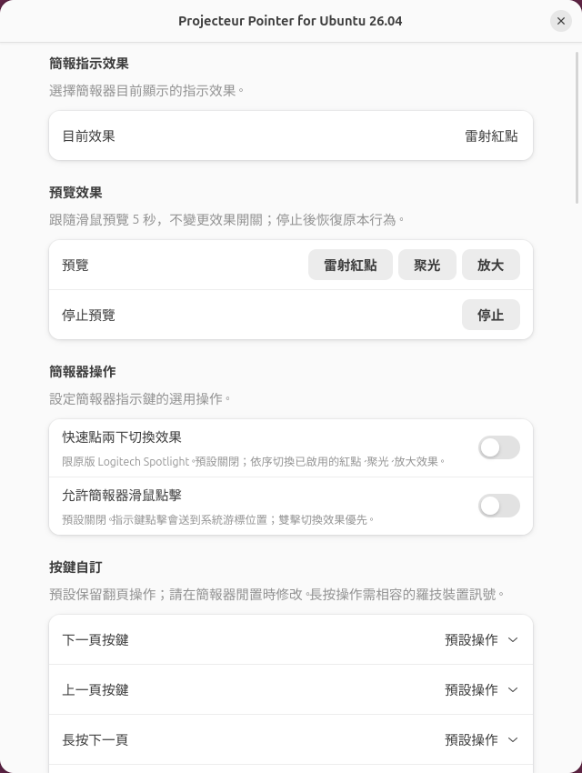

# Projecteur GNOME

Laser dot, spotlight, and local magnification for **Logitech Spotlight** on **Ubuntu 26.04,
GNOME Shell 50, and Wayland**.

[繁體中文](README.zh-TW.md) · [Developer notes](gnome/README.md) ·
[Upstream Projecteur](https://github.com/gbin/Projecteur)

This fork reuses Projecteur's presenter device handling and adds a GNOME Shell
extension for the on-screen pointer. The GNOME path builds independently of
Plasma. It has been tested locally with GNOME 50.1, a Logitech Spotlight USB
receiver (`046d:c53e`), and OnlyOffice fullscreen presentations.


The purple dot on the display is the software pointer. The red arrow is an annotation in this demo photo.

## Features

- Laser dot, spotlight, and circular magnifier controlled by presenter movement.
- Adjustable spotlight/lens diameter (80–1200 logical pixels) and zoom (1.1–8 times).
- Optional native double-click mode switching for original Spotlight, off by default.
- Adjustable color and diameter, with matching border and glow.
- Hide the system cursor while the dot is visible; restore it afterward.
- Adjustable idle duration: 0.1–30 seconds, default 3 seconds.
- Previous/next slide forwarding and fullscreen overlay support.
- Preferences saved automatically and applied immediately.
- Traditional Chinese for Chinese locales, including Simplified Chinese system
  locales; English for other locales. GTK's built-in dialog controls follow
  the system's own translations.

## Install

Download and extract this repository's source ZIP, open a terminal in the
extracted folder, and run:

```sh
./install.sh
```

Run it as your normal desktop user. The installer handles build dependencies,
compilation, device permissions, the user service, and extension enablement.
It may request your administrator password for missing packages or device
permissions. The daemon and extension are installed in your user account.

**The GNOME extension is included.** You do not need to install it separately
from the GNOME Extensions website. The background service reads the presenter;
the extension displays the dot and provides the preferences window.

**Reconnect the presenter, then log out and back in.** The extension will be
enabled automatically; no second installation command is needed. Updates use
this same command and preserve your saved preferences.

If dependencies and device permissions are managed separately:

```sh
./install.sh --no-system-changes
```

Automatic installation targets Ubuntu 26.04 / GNOME 50 / Wayland.
Other distributions and GNOME versions have not been validated.

## Configure

**Always show the pointer effect** is off by default. When enabled, the selected
effect appears immediately and stays visible; the linger-time control in
**Display behavior** is disabled. Turning it off restores the saved timeout.
**Center on the remembered monitor each time the pointer button is pressed** is also off by
default. It remembers the physical monitor where the effect last stopped and
moves both the effect and system cursor to that monitor's center on every reported
pointer-button press, including while the effect is still visible. If that monitor is unavailable, it uses the monitor currently
containing the mouse cursor. Native press reporting varies by presenter;
models that do not report a pointer-button press still center on effect activation.

Click the outline **◎** target icon on the right of the top bar to select the
current effect, toggle double-click switching, cursor hiding or presenter clicks,
and enable each effect. Choose **Open preferences** for color, size, linger time,
spotlight dimming, magnification and resets. The symbolic icon follows the Shell
theme, and the menu stays in sync with the preferences window.

1. After installation and logging back in, search for **Extensions** in the
   application overview.
2. Find **Projecteur Pointer for Ubuntu 26.04** and make sure it is enabled.
3. Click its settings button to open the pointer preferences.

If the Extensions management app is not installed, or you prefer to open
preferences directly, run this command in a terminal. No additional management
app is required:

```sh
gnome-extensions prefs projecteur-pointer-ubuntu26@projecteur.github.io
```

Preferences captured on a local Traditional Chinese desktop:



From top to bottom: color, size, mouse cursor hiding, linger duration, and reset
appearance. Click the color swatch, use `−` / `+` for numeric values, and use the
switch for cursor hiding. Changes are saved and applied immediately. The purple
color, 30-pixel diameter, and 3-second duration are example preferences.
On non-Chinese systems, these controls appear in English.

Choose the color, diameter (6–96 logical pixels), whether to hide the mouse
cursor, and how long the dot stays visible after movement stops. Hold the
Spotlight pointer button and move the presenter to control the dot.

The idle duration starts at the **last movement**, because this device path
does not expose a reliable pointer-button release event. Holding the button
still does not prevent the idle timeout. Fullscreen direct scanout is paused
while the dot is visible and restored when it disappears.

### Spotlight, magnification, and double-click switching

Fresh installations enable only the laser dot; spotlight and magnifier start
disabled. Upgrades preserve existing effect toggle values.

Select **Presenter effects → Current effect** in preferences. Spotlight darkens
surrounding content while leaving a circular bright area. Magnifier displays a
live circular lens following the pointer; it does not change GNOME accessibility
zoom settings.

- **Spotlight**: enable or disable it, set its diameter (80–1200 logical pixels),
  and adjust background dimming.
- **Magnifier**: enable or disable it, set its diameter (80–1200 logical pixels),
  and set magnification (1.1–8 times). The lens fits inside its current monitor.
- **Double-click to switch effects**: opt in to cycle laser dot → spotlight →
  magnifier → laser dot with the original Logitech Spotlight pointer button.
  Disabled effects are skipped. This option is off by default; disabling it
  restores the device's double-click mapping. Slide navigation retains its
  existing behavior.

- **Allow presenter mouse clicks**: off by default to avoid accidental pointer-button
  clicks. When enabled, left mouse clicks are forwarded at the system cursor.
  If double-click switching is enabled, native double clicks switch effects
  rather than reaching the application. Ordinary mice are unaffected. In an
  application that locks the system cursor, its click position can differ from
  the visual effect's position.
- **Center on the remembered monitor each time the pointer button is pressed** identifies the
  last-used physical display by connector. In a multi-monitor presentation it
  can return to the external presentation display instead of the laptop panel.
  Moving the system cursor with the effect keeps optional presenter clicks aligned.
- **Reset spotlight appearance** restores a 300-pixel diameter and 0.65 dimming.
- **Reset magnifier appearance** restores a 300-pixel diameter and 2.0 zoom.
  Both reset buttons preserve effect enablement, the current mode, and click
  and double-click options.

All effects share cursor hiding and the movement idle timeout. The current-effect selector lists only
enabled effects. The laser dot can also be disabled in its appearance group.
With all three disabled, the selector shows a gray prompt to enable an effect
and the system cursor is restored. The screenshot above shows the
previous laser-only preferences; the new effect controls appear at the top.
The user confirmed laser, spotlight, magnifier, native double-click switching,
mouse clicks, and preferences on the original Spotlight USB device on 2026-10-11.

## Other presenters

This fork inherits upstream develop's device entries for AVATTO, August, Lenovo,
Norwii, Kensington, and Microsoft Presenter+. Devices providing compatible
relative mouse movement can try all three effects. **These additional devices
have not been verified on this GNOME fork.**

The original Spotlight USB laser dot and slide navigation have been tested.
Spotlight Bluetooth, Spotlight 2, and other models are unverified. Native
double-click switching currently applies only to original Spotlight; other
presenters can select effects in preferences and do not receive Spotlight's
model-specific reprogramming commands. See the
[compatibility table](gnome/DEVICE-SUPPORT.md) for IDs and limitations.

## Let an AI assistant help

This repository includes [AGENTS.md](AGENTS.md) with installation,
configuration, troubleshooting, and validation instructions for AI assistants
with access to your Linux computer. You can copy this prompt:

> Read README.md and AGENTS.md in this repository. Check whether my system is
> Ubuntu 26.04 with GNOME 50 on Wayland, then help me install and configure
> Projecteur GNOME for my Logitech Spotlight. Preserve existing settings,
> explain any administrator access needed, and do not log me out or reboot.
> After I log in again, check the service and extension, then guide me through
> testing the pointer, cursor hiding, fullscreen presentations, and slide
> navigation.

An assistant that only has chat access can explain the steps; installation
requires access to your computer. Enter any administrator password only in
Ubuntu's normal password prompt.

## Remove

```sh
./uninstall.sh
```

This removes the user service, daemon, and extension. Saved preferences and
the system udev permission rules are retained.

## Troubleshooting

Check extension and service status:

```sh
gnome-extensions info projecteur-pointer-ubuntu26@projecteur.github.io
systemctl --user status projecteur-gnome-daemon.service
journalctl --user -b -u projecteur-gnome-daemon.service --no-pager
```

If an update appears unchanged, log out and back in to reload GNOME's extension
code. If the presenter is missing, reconnect it and check the daemon log.
Detailed build and test instructions are in [gnome/README.md](gnome/README.md).

## Attribution and license

Based on [Projecteur](https://github.com/gbin/Projecteur), created by Jahn Fuchs
and maintained upstream by Guillaume Binet and contributors. This fork adds
the GNOME daemon, Shell overlay, pointer preferences, and local installation
workflow. It is an independent community adaptation.

The MIT license and original copyright notice are preserved in
[LICENSE.md](LICENSE.md). The upstream KDE implementation remains in the source
tree; follow the upstream documentation if you want to build that path.
