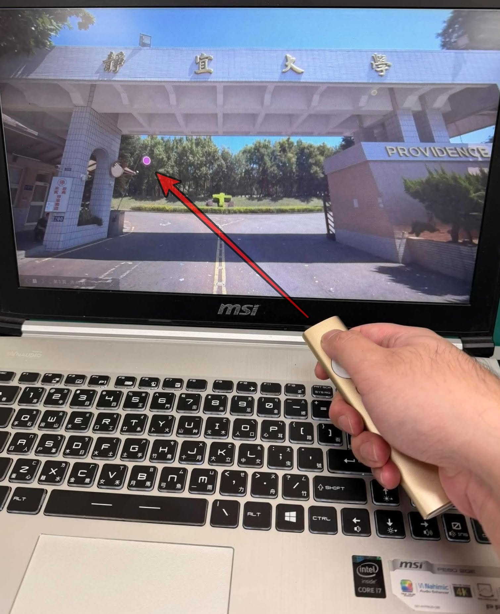

# Projecteur GNOME

A configurable laser dot for **Logitech Spotlight** on **Ubuntu 26.04,
GNOME Shell 50, and Wayland**.

[繁體中文](README.zh-TW.md) · [Developer notes](gnome/README.md) ·
[Upstream Projecteur](https://github.com/gbin/Projecteur)

This fork reuses Projecteur's presenter device handling and adds a GNOME Shell
extension for the on-screen pointer. The GNOME path builds independently of
Plasma. It has been tested locally with GNOME 50.1, a Logitech Spotlight USB
receiver (`046d:c53e`), and OnlyOffice fullscreen presentations.



The purple dot on the display is the software pointer. The red arrow is an annotation in this demo photo.

## Features

- Laser dot controlled by presenter movement.
- Adjustable color and diameter, with matching border and glow.
- Hide the system cursor while the dot is visible; restore it afterward.
- Adjustable idle duration: 0.1–30 seconds, default 3 seconds.
- Previous/next slide forwarding and fullscreen overlay support.
- Preferences saved automatically and applied immediately.
- Traditional Chinese for Chinese locales, including Simplified Chinese system
  locales; English for other locales. GTK's built-in dialog controls follow
  the system's own translations.

## Install

Download and extract this repository's source ZIP, open a terminal in the
extracted folder, and run:

```sh
./install.sh
```

Run it as your normal desktop user. The installer handles build dependencies,
compilation, device permissions, the user service, and extension enablement.
It may request your administrator password for missing packages or device
permissions. The daemon and extension are installed in your user account.

**Reconnect the presenter, then log out and back in.** The extension will be
enabled automatically; no second installation command is needed. Updates use
this same command and preserve your saved preferences.

If dependencies and device permissions are managed separately:

```sh
./install.sh --no-system-changes
```

Automatic installation targets Ubuntu 26.04 / GNOME 50 / Wayland.
Other distributions and GNOME versions have not been validated.

## Configure

Open **Extensions → Projecteur Pointer for Ubuntu 26.04 → Settings**, or run:

```sh
gnome-extensions prefs projecteur-pointer-ubuntu26@projecteur.github.io
```

Choose the color, diameter (6–96 logical pixels), whether to hide the mouse
cursor, and how long the dot stays visible after movement stops. Hold the
Spotlight pointer button and move the presenter to control the dot.

The idle duration starts at the **last movement**, because this device path
does not expose a reliable pointer-button release event. Holding the button
still does not prevent the idle timeout. Fullscreen direct scanout is paused
while the dot is visible and restored when it disappears.

## Let an AI assistant help

This repository includes [AGENTS.md](AGENTS.md) with installation,
configuration, troubleshooting, and validation instructions for AI assistants
with access to your Linux computer. You can copy this prompt:

> Read README.md and AGENTS.md in this repository. Check whether my system is
> Ubuntu 26.04 with GNOME 50 on Wayland, then help me install and configure
> Projecteur GNOME for my Logitech Spotlight. Preserve existing settings,
> explain any administrator access needed, and do not log me out or reboot.
> After I log in again, check the service and extension, then guide me through
> testing the pointer, cursor hiding, fullscreen presentations, and slide
> navigation.

An assistant that only has chat access can explain the steps; installation
requires access to your computer. Enter any administrator password only in
Ubuntu's normal password prompt.

## Remove

```sh
./uninstall.sh
```

This removes the user service, daemon, and extension. Saved preferences and
the system udev permission rules are retained.

## Troubleshooting

Check extension and service status:

```sh
gnome-extensions info projecteur-pointer-ubuntu26@projecteur.github.io
systemctl --user status projecteur-gnome-daemon.service
journalctl --user -b -u projecteur-gnome-daemon.service --no-pager
```

If an update appears unchanged, log out and back in to reload GNOME's extension
code. If the presenter is missing, reconnect it and check the daemon log.
Detailed build and test instructions are in [gnome/README.md](gnome/README.md).

## Attribution and license

Based on [Projecteur](https://github.com/gbin/Projecteur), created by Jahn Fuchs
and maintained upstream by Guillaume Binet and contributors. This fork adds
the GNOME daemon, Shell overlay, pointer preferences, and local installation
workflow. It is an independent community adaptation.

The MIT license and original copyright notice are preserved in
[LICENSE.md](LICENSE.md). The upstream KDE implementation remains in the source
tree; follow the upstream documentation if you want to build that path.
