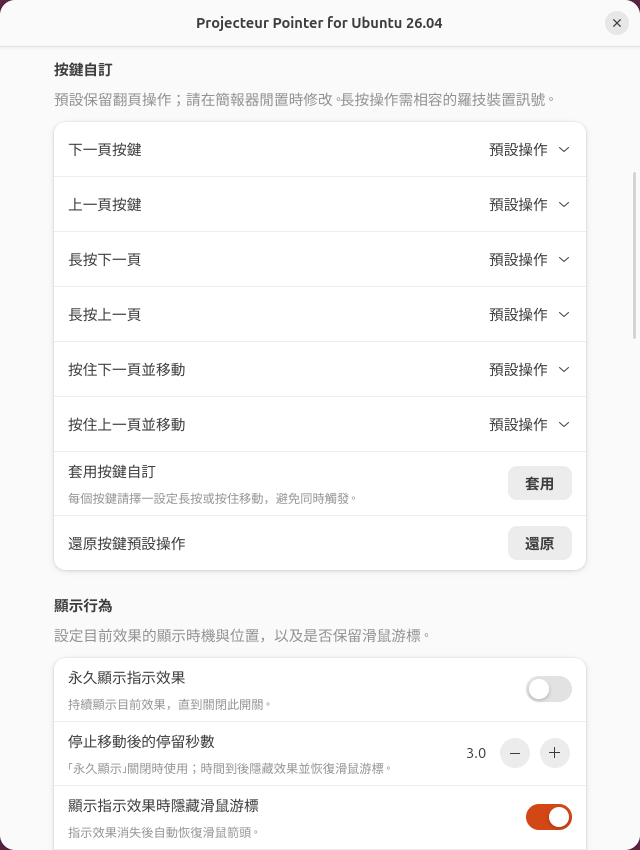
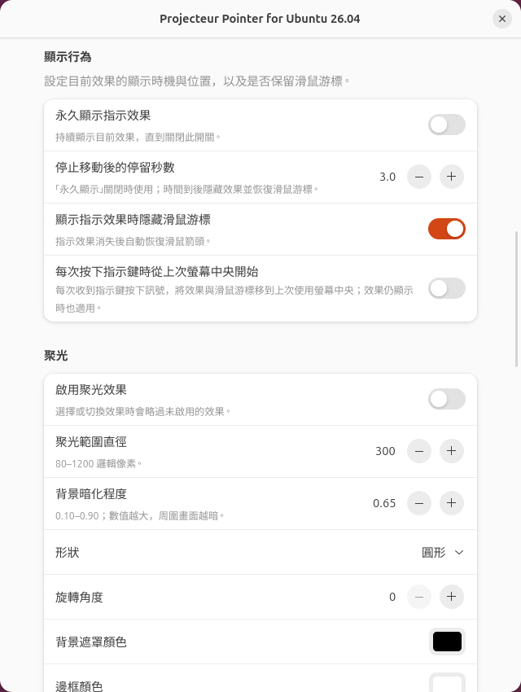
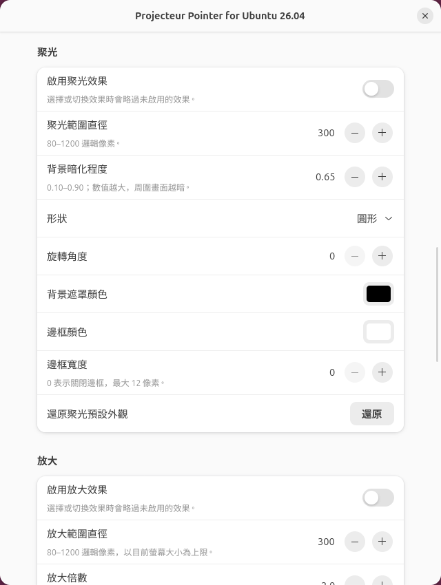
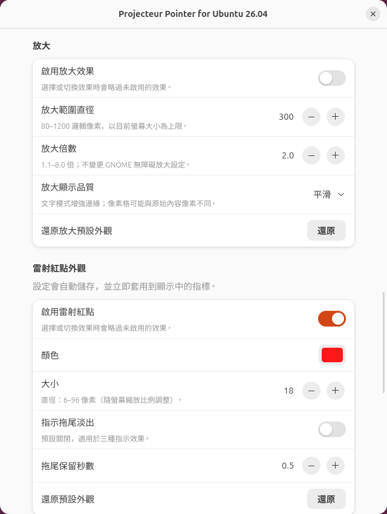
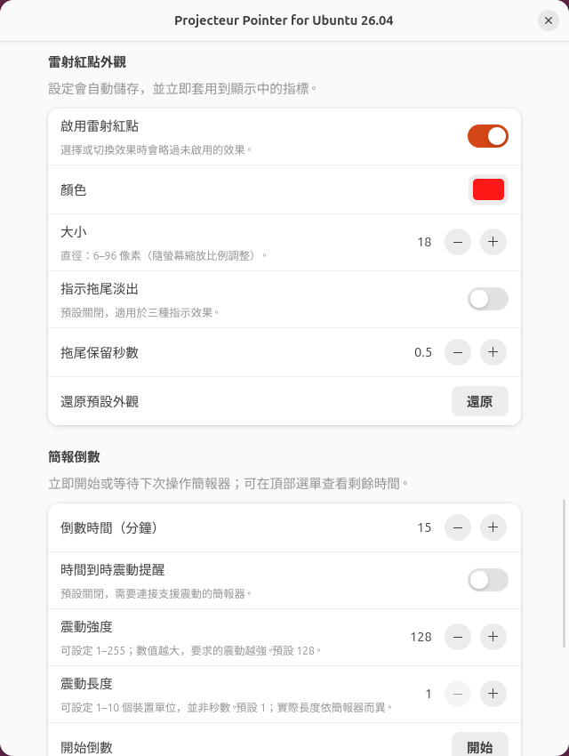
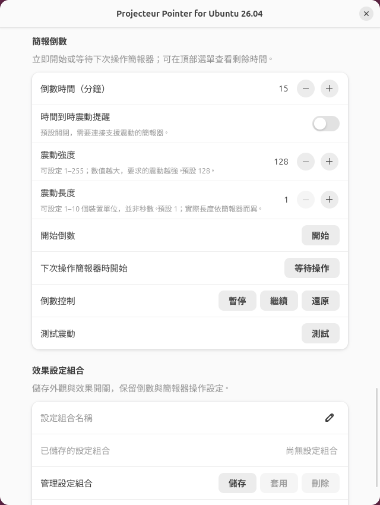
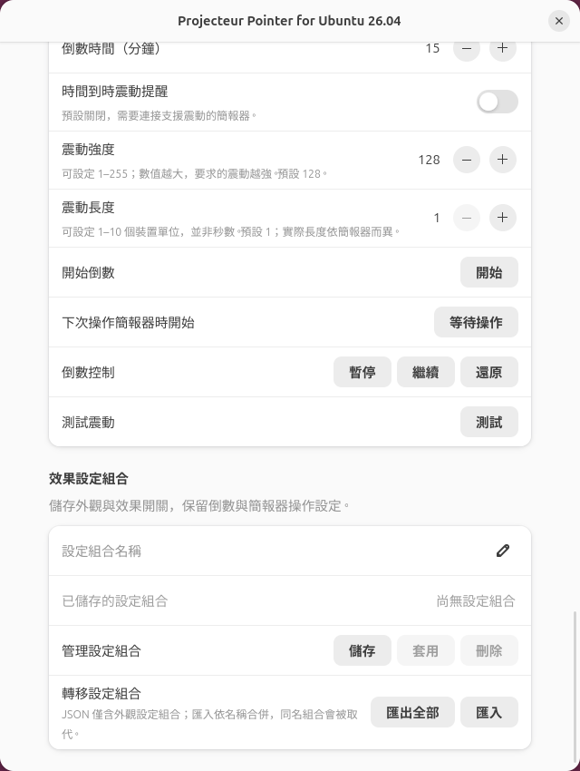

# Projecteur GNOME

**本專案使用 Codex AI 協助改作，基於上游 Projecteur 開發 GNOME 相容版本，
並由專案維護者進行實機測試。**

在 **Ubuntu 26.04／GNOME Shell 50／Wayland** 上，使用 **Logitech Spotlight**
控制可調整的雷射紅點、聚光與局部放大效果。

[English](README.md) · [開發說明](gnome/README.md) ·
[原始 Projecteur](https://github.com/gbin/Projecteur)

本專案是 Projecteur 的 GNOME 相容版本，沿用原專案的簡報器處理程式，並加入
GNOME Shell 擴充功能。GNOME 版本可獨立建置，不需安裝 Plasma。
目前已在 GNOME 50.1、Logitech Spotlight USB 接收器（`046d:c53e`）及
OnlyOffice 全螢幕簡報環境完成本機測試。


畫面中的紫色光點為本專案的指標；紅色箭頭為這張示範照片的標註。

## 功能

- 使用簡報器移動控制雷射紅點、聚光或圓形放大鏡。
- 聚光與放大範圍可調整為 80–1200 邏輯像素；放大可調整為 1.1–8 倍。
- 聚光背景暗化程度可調整，聚光及放大可個別停用。
- 原版 Spotlight 可選用快速點兩下指示鍵切換效果（預設關閉）。
- 調整顏色與大小，邊框及光暈會跟隨所選顏色。
- 紅點顯示時隱藏滑鼠箭頭，結束後自動恢復。
- 調整停止移動後的停留時間：0.1–30 秒，預設 3 秒。
- 保留上一頁／下一頁操作，支援全螢幕畫面覆蓋。
- 設定自動儲存並立即套用。
- 中文語系（包含簡體中文系統）顯示繁體中文，其他語系顯示英文。
  GTK 內建對話框的系統按鈕使用系統提供的翻譯。

## 安裝

下載並解壓縮本專案的原始碼 ZIP，在解壓縮後的資料夾開啟終端機，執行：

```sh
./install.sh
```

請以一般桌面使用者執行，不要在指令前加 `sudo`。安裝程式會處理缺少的建置套件、
編譯、裝置權限、使用者服務及擴充功能啟用。安裝缺少的套件或裝置權限時，
可能需要輸入管理員密碼；程式與擴充功能會安裝到你的使用者帳號。

**已包含 GNOME 擴充功能**，不需要再到 GNOME Extensions 網站另外安裝。
背景服務負責讀取簡報器，擴充功能負責顯示紅點並提供設定視窗。

**重新連接簡報器，再登出並登入。** 擴充功能會自動啟用，不需要再執行第二個
安裝指令。更新也使用同一個指令，既有設定會保留。

如果已由其他方式安裝套件及裝置權限，可使用：

```sh
./install.sh --no-system-changes
```

自動安裝支援 Ubuntu 26.04／GNOME 50／Wayland；其他發行版與 GNOME 版本尚未驗證。

## 設定與操作

「**永久顯示指示效果**」預設關閉。開啟後，立即持續顯示目前效果，
「顯示行為」中的停留秒數會變灰停用；關閉後恢復原本的停留秒數。
「**每次按下指示鍵時從上次螢幕中央開始**」也預設關閉。開啟後會記住指示效果
最後停留的螢幕；每次收到指示鍵按下訊號，將效果與系統滑鼠游標一起移到該螢幕中央，
即使效果仍顯示也適用。
外接螢幕未連接時，會改用目前滑鼠游標所在螢幕。
不同簡報器的按鍵訊號可能不同；未回報指示鍵按下的型號仍只在效果啟動時置中。

點擊頂部工作列右側的線條式 **◎** 靶心圖示，可切換目前效果、雙擊切換、
隱藏游標、簡報器滑鼠點擊，以及三種效果的開關。選擇「**開啟完整設定**」
可調整顏色、大小、停留秒數、聚光暗化、放大倍數與還原預設。
圖示顏色隨 GNOME Shell 主題變化，快捷選單與設定視窗會同步更新。

1. 安裝完成並重新登入後，在應用程式搜尋「**擴充功能**」（Extensions）。
2. 找到「**Projecteur Pointer for Ubuntu 26.04**」，確認開關已啟用。
3. 按該項目的設定按鈕，開啟紅點設定。

若系統沒有安裝「擴充功能」管理程式，或希望直接開啟設定，
可在終端機執行以下指令（不需要額外安裝管理程式）：

```sh
gnome-extensions prefs projecteur-pointer-ubuntu26@projecteur.github.io
```

本機擷取的新版本原生設定畫面（繁體中文，使用隔離環境中的預設設定）：

<details>
<summary>效果選擇與直接預覽</summary>


</details>

<details>
<summary>簡報器按鍵自訂</summary>



</details>

<details>
<summary>顯示行為與游標隱藏</summary>



</details>

<details>
<summary>聚光外觀</summary>



</details>

<details>
<summary>放大外觀與顯示品質</summary>



</details>

<details>
<summary>雷射紅點與拖尾淡出</summary>



</details>

<details>
<summary>簡報倒數與震動</summary>



</details>

<details>
<summary>設定組合與 JSON 匯出／匯入</summary>



</details>

可用「**預覽效果**」直接查看五秒預覽；大多數設定會立即套用，
「按鍵自訂」需按「**套用**」。數值選項已標示範圍，
「**轉移設定組合**」提供 JSON 匯出及匯入。

可調整顏色、直徑（6–96 邏輯像素）、是否隱藏滑鼠箭頭，以及停止移動後保留紅點
的秒數。按住 Spotlight 指示鍵並移動簡報器，即可控制紅點。

停留時間從**最後一次移動**開始計算，因為此裝置處理方式無法可靠取得指示鍵的
放開事件。因此，即使持續按住按鍵，只要停止移動也會開始計時。
紅點顯示期間會暫停全螢幕 direct scanout，消失後會恢復。

### 聚光、放大與雙擊切換

新安裝預設只啟用雷射紅點，聚光及放大關閉；更新會保留既有的開關設定。

在設定視窗的「**簡報指示效果 → 目前效果**」選擇紅點、聚光或放大。
聚光會暗化周圍畫面，保留圓形亮區；放大則顯示跟隨指標的即時圓形放大鏡，
不會變更 GNOME 無障礙放大設定。

- **聚光**：可開關選用、調整範圍直徑（80–1200 邏輯像素）與背景暗化程度。
- **放大**：可開關選用、調整範圍直徑（80–1200 邏輯像素）與倍數（1.1–8 倍）。
  放大鏡大小以目前螢幕為上限，靠近邊緣時會保持在該螢幕內。
- **快速點兩下切換效果**：開啟後，原版 Logitech Spotlight 可快速點兩下指示鍵，
  依「紅點 → 聚光 → 放大 → 紅點」切換，略過未啟用的效果。預設關閉。
  上一頁與下一頁保留原本操作；關閉選項會還原雙擊的裝置映射。

- **允許簡報器滑鼠點擊**：預設關閉，避免指示鍵單擊誤觸應用程式。
  開啟後，簡報器左鍵點擊會送到系統游標位置。若同時啟用雙擊切換，雙擊會優先
  切換效果，不會送出應用程式雙擊。此選項只控制簡報器，不影響一般滑鼠。
  全螢幕程式若鎖住系統游標，點擊位置仍以系統游標為準，可能與指示效果位置不同。
- **每次按下指示鍵時從上次螢幕中央開始**：以螢幕接頭識別最後使用的螢幕，
  在多螢幕簡報時可回到外接簡報畫面，而不是筆電畫面。啟動時會同時移動
  系統滑鼠游標，因此簡報器滑鼠點擊仍會與指示效果對齊。
- **還原聚光預設外觀**：直徑回到 300 邏輯像素、暗化程度回到 0.65。
- **還原放大預設外觀**：直徑回到 300 邏輯像素、倍數回到 2.0。
  兩個還原按鈕都保留效果啟用狀態、目前模式、點擊選項與雙擊切換選項。

三種效果共用游標隱藏及停止移動後的停留秒數。「目前效果」只列出已啟用的效果。
雷射也可在「雷射紅點外觀」中停用；三項全關時，「目前效果」會以灰字提示
「請先啟用其中一個指示效果」，並恢復系統游標。上述截圖展示先前版本的紅點設定；新增效果位於設定視窗上方。
雷射、聚光、放大、雙擊切換、滑鼠點擊及設定選項，已於 2026-10-11
由使用者以原版 Spotlight USB 確認運作正常。

### 倒數、效果設定組合與裝置狀態

頂部選單可開始、等待下次操作、暫停、繼續及歸零簡報倒數。
在完整設定中調整時間（1–1440 分鐘，預設 15 分鐘）。
等待模式在下次收到簡報器操作訊號時開始，也包含指示移動。
頂部工作列顯示剩餘時間，時間到會通知。
震動提醒預設關閉，需簡報器具備相容的 HID++ 功能；請用「測試震動」確認。
這批新增功能的實體震動尚待本機驗證；震動長度為裝置協定單位，不是秒數。
重新啟動背景服務會清除正在進行的倒數。

「效果設定組合」可儲存具名的外觀與效果開關，在完整設定中儲存、套用或刪除，
也可從頂部選單直接套用；不會覆寫游標、滑鼠點擊、置中與倒數設定。
「已連接的簡報器」顯示裝置回報的電量與充電狀態；無法取得時會明確標示。
電量低於或等於 15% 時會通知。


### 進階效果與按鍵自訂

完整設定新增圓形／正方形／菱形聚光、旋轉角度、背景與邊框顏色、邊框寬度，
以及預設關閉的拖尾淡出。放大品質可選平滑、文字與介面、像素格；
像素格不保證等同原始內容的像素。還原外觀也會還原這些新增設定。

「預覽效果」會跟隨滑鼠顯示 5 秒，也能預覽目前停用的效果。
按「停止」可提早結束；之後恢復原本行為，不會改動效果開關或啟動簡報倒數。

「按鍵自訂」可設定上一頁／下一頁的點按、長按或按住移動操作，選用鍵盤快捷鍵、
切換組合／效果、倒數、捲動或音量控制。請在簡報器閒置時按「套用」。
預設保留翻頁操作；「還原按鍵預設操作」只清除按鍵自訂。
長按操作需要相容的羅技裝置訊號，本專案新增的操作仍待實體測試。

「轉移設定組合」可將全部已儲存組合匯出成 JSON；匯入會先驗證整份檔案，
依名稱合併並取代同名組合，不會自動套用效果。檔案僅含外觀組合。

安裝程式也包含命令列控制工具 `projecteur-gnome`，例如：
`projecteur-gnome preview laser --seconds 5` 或
`projecteur-gnome timer start --minutes 15`。
詳細指令請看 `projecteur-gnome --help` 與[開發說明](gnome/README.md)。
全域快捷鍵暫時排到後續處理。


## 其他簡報器相容性

本專案沿用上游開發版的裝置清單，包括 AVATTO、August、Lenovo、Norwii、
Kensington 與 Microsoft Presenter+。只要裝置提供相容的相對滑鼠移動事件，
即可嘗試三種效果；**清單內其他裝置尚無實機驗證**。

原版 Spotlight USB 的既有紅點及換頁功能已測試；Spotlight Bluetooth、Spotlight 2
及其他型號尚未驗證。雙擊切換目前限定原版 Spotlight；其他簡報器可由設定視窗
選擇效果，不會套用 Spotlight 專用的重編程指令。
完整型號、裝置 ID 與測試限制見 [裝置相容性表](gnome/DEVICE-SUPPORT.md)。

## 使用 AI 助手協助配置

本專案提供 [AGENTS.md](AGENTS.md)，包含 AI 助手可遵循的安裝、設定、除錯與
驗證指示。若你的 AI 助手能存取這台 Linux 電腦，可複製以下提示詞：

> 請先閱讀這個專案的 README.zh-TW.md 與 AGENTS.md，確認我的系統是否為
> Ubuntu 26.04、GNOME 50 與 Wayland，再協助我安裝及設定 Projecteur GNOME，
> 搭配 Logitech Spotlight 使用。請保留既有設定，說明需要的管理員權限，
> 不要自動登出或重新開機。等我重新登入後，檢查服務與擴充功能狀態，再帶我
> 測試紅點、游標隱藏、全螢幕簡報及上一頁／下一頁操作。

只有聊天功能的 AI 可以提供操作指引；實際安裝需要它能存取電腦。
管理員密碼只需在 Ubuntu 正常的密碼提示中輸入。

## 移除

```sh
./uninstall.sh
```

會移除使用者服務、程式與擴充功能。已儲存的偏好設定及系統 udev 權限規則會保留。

## 除錯

```sh
gnome-extensions info projecteur-pointer-ubuntu26@projecteur.github.io
systemctl --user status projecteur-gnome-daemon.service
journalctl --user -b -u projecteur-gnome-daemon.service --no-pager
```

更新後若仍看到舊版功能，請登出再登入，以重新載入 GNOME 擴充程式。
無法偵測簡報器時，請重新連接裝置並查看服務紀錄。
更多建置及測試指令請見 [gnome/README.md](gnome/README.md)。

## 原專案與授權

本專案以 [Projecteur](https://github.com/gbin/Projecteur) 為基礎，原作者為
Jahn Fuchs，上游由 Guillaume Binet 與貢獻者維護。本相容版本新增 GNOME daemon、
畫面覆蓋、指標設定及本機安裝流程，為獨立的社群改作。

[LICENSE.md](LICENSE.md) 保留 MIT 授權及原作者版權聲明。
原本的 KDE 實作仍保留於原始碼中；建置 KDE 版本請參考上游文件。
